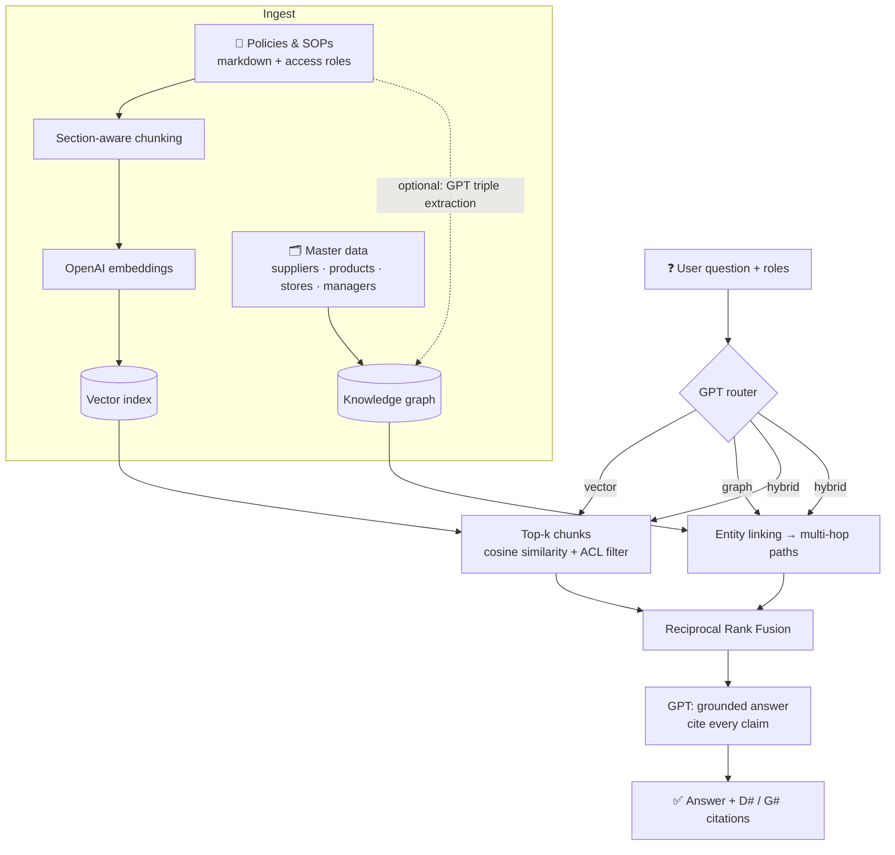

# 🛒 Enterprise Hybrid RAG: Vector RAG + Graph RAG with GPT

> **Vector RAG finds the right paragraph. Graph RAG connects the relationships. Hybrid RAG does both.**

A complete, runnable reference implementation of **Hybrid Retrieval-Augmented Generation** for the enterprise,
explained with a supermarket chain (*DailyBasket*). It combines semantic search over policy documents with
multi-hop traversal over a knowledge graph, then uses a **GPT model** to write a grounded answer with citations.

> 🚧 **Work in progress.** Building this over weekends.

---

## 💡 Why hybrid?

| Question | What it needs | Lane |
|---|---|---|
| *"How many sick leaves do store staff get?"* | One paragraph in the HR policy | 📄 **Vector RAG** |
| *"FreshDairy milk is recalled. Which stores and managers are affected?"* | Supplier → Product → Store → Manager links. No single document has this | 🕸️ **Graph RAG** |
| *"Milk recall: what must each affected store manager do?"* | **Who** is affected (graph) + **what to do** (Recall SOP) | 🤝 **Hybrid RAG** |

Vector-only RAG answers the first question well and struggles with the other two. Most real enterprise
questions look like the third one.

---

## 🏗️ Architecture

| Step | Module | What happens |
|---|---|---|
| 1. Ingest documents | `chunking.py` | Markdown with front matter (`title`, `access`). Split by section, then packed to ~600 chars with overlap. Each chunk is embedded with a *contextual header* (`Title — Section`). |
| 2. Vector index | `vector_store.py` | NumPy cosine-similarity index persisted to `.index/`. Role-based **access filter** applied at query time. |
| 3. Knowledge graph | `graph_store.py` | NetworkX graph loaded from `data/graph/*.csv`. Optional GPT extraction of extra triples from documents (`extraction.py`). |
| 4. Route | `router.py` | GPT classifies the question as `vector`, `graph` or `hybrid` (JSON mode), with a rule-based fallback. |
| 5. Retrieve | `pipeline.py` | **Vector:** top-k chunks. **Graph:** link entities by name/alias (GPT + fuzzy match fallback), walk downstream up to 3 hops and upstream up to 2, and rank paths that connect several entities or match question terms first. |
| 6. Fuse | `fusion.py` | Reciprocal Rank Fusion merges both lanes without comparing incompatible scores. |
| 7. Generate | `pipeline.py` | GPT answers **only** from the context, citing `[D1]` for documents and `[G1]` for graph paths, and says "I don't know" otherwise. |

---

## 📄 License

MIT © 2026 **Sudharsan SambathKumar**
