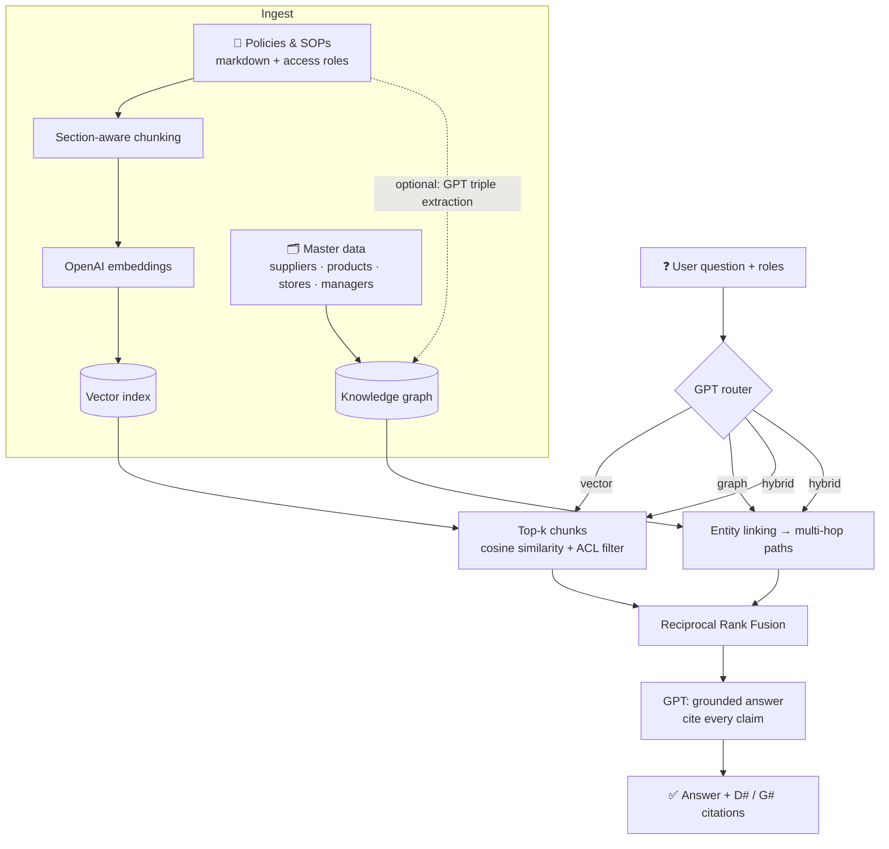

# 🛒 Enterprise Hybrid RAG: Vector RAG + Graph RAG with GPT

> **Vector RAG finds the right paragraph. Graph RAG connects the relationships. Hybrid RAG does both.**

A complete, runnable reference implementation of **Hybrid Retrieval-Augmented Generation** for the enterprise,
explained with a supermarket chain (*DailyBasket*). It combines semantic search over policy documents with
multi-hop traversal over a knowledge graph, then uses a **GPT model** to write a grounded answer with citations.

---

## 💡 Why hybrid?

| Question | What it needs | Lane |
|---|---|---|
| *"How many sick leaves do store staff get?"* | One paragraph in the HR policy | 📄 **Vector RAG** |
| *"FreshDairy milk is recalled. Which stores and managers are affected?"* | Supplier → Product → Store → Manager links. No single document has this | 🕸️ **Graph RAG** |
| *"Milk recall: what must each affected store manager do?"* | **Who** is affected (graph) + **what to do** (Recall SOP) | 🤝 **Hybrid RAG** |

Vector-only RAG answers the first question well and struggles with the other two. Most real enterprise
questions look like the third one.

---

## 🏗️ Architecture



| Step | Module | What happens |
|---|---|---|
| 1. Ingest documents | `chunking.py` | Markdown with front matter (`title`, `access`). Split by section, then packed to ~600 chars with overlap. Each chunk is embedded with a *contextual header* (`Title — Section`). |
| 2. Vector index | `vector_store.py` | NumPy cosine-similarity index persisted to `.index/`. Role-based **access filter** applied at query time. |
| 3. Knowledge graph | `graph_store.py` | NetworkX graph loaded from `data/graph/*.csv`. Optional GPT extraction of extra triples from documents (`extraction.py`). |
| 4. Route | `router.py` | GPT classifies the question as `vector`, `graph` or `hybrid` (JSON mode), with a rule-based fallback. |
| 5. Retrieve | `pipeline.py` | **Vector:** top-k chunks. **Graph:** link entities by name/alias (GPT + fuzzy match fallback), walk downstream up to 3 hops and upstream up to 2, and rank paths that connect several entities or match question terms first. |
| 6. Fuse | `fusion.py` | Reciprocal Rank Fusion merges both lanes without comparing incompatible scores. |
| 7. Generate | `pipeline.py` | GPT answers **only** from the context, citing `[D1]` for documents and `[G1]` for graph paths, and says "I don't know" otherwise. |

---

## 🚀 Quickstart

```bash
git clone https://github.com/SudharsanSambathkumar/enterprise-hybrid-rag.git
cd enterprise-hybrid-rag

python -m venv .venv && source .venv/bin/activate   # Windows: .venv\Scripts\activate
pip install -e ".[ui,dev]"

cp .env.example .env        # then put your OPENAI_API_KEY in .env
hybrid-rag ingest           # chunk + embed docs, build the graph
```

**No API key yet?** Set `LLM_PROVIDER=fake` in `.env` to run everything offline, with deterministic embeddings
and an extractive answer. Swap back to `openai` for real GPT answers.

### Ask questions (CLI)

```bash
# 📄 Vector
hybrid-rag ask "How many sick leaves do store staff get?"

# 🕸️ Graph
hybrid-rag ask "FreshDairy milk is recalled. Which stores and managers are affected?"

# 🤝 Hybrid (the Recall SOP is restricted to managers, so pass the role)
hybrid-rag ask "Milk recall: what must each affected store manager do?" --role manager

# Options
hybrid-rag ask "Who supplies bread?" --route graph --show-context
hybrid-rag ask "..." --json          # full structured output
hybrid-rag chat --role manager       # interactive loop
hybrid-rag ingest --extract-graph    # also let GPT add triples from the documents
```

Example output (GPT):

```text
● Route: HYBRID — Needs affected stores (graph) and the recall procedure (documents)
● Graph entities: Milk 1L
● Roles: manager

Two stores are affected: Koramangala, managed by Ravi [G1], and Whitefield, managed by Priya [G2].
Each manager must:
- Pull all affected stock within 2 hours of the alert [D1]
- Move it to the red-tagged quarantine area [D3]
- Notify loyalty customers within 24 hours [D2]
- Log the recall in the QA portal and call the regional manager, since it involves dairy [D4]

Sources:
  [G1] Graph: Milk 1L → Koramangala → Ravi
  [D1] Product Recall SOP › Step 1: Pull Stock
  ...
```

*(Exact wording depends on the model.)*

### REST API

```bash
make api      # uvicorn hybrid_rag.api:app --reload  → http://localhost:8000/docs
```

```bash
curl -X POST localhost:8000/ask -H "Content-Type: application/json" \
  -d '{"question": "Which stores stock FreshDairy milk?", "roles": ["staff"], "route": "auto"}'
```

| Method | Path | Body |
|---|---|---|
| `GET` | `/health` | |
| `POST` | `/ask` | `{question, roles?, route?: auto\|vector\|graph\|hybrid}` |
| `POST` | `/ingest` | `{extract_graph?: bool}` |
| `GET` | `/graph/stats` | |

### Streamlit UI

```bash
make ui       # streamlit run app/streamlit_app.py
```

Shows the chosen route, the answer, the document evidence and the graph paths side by side, with a role picker.

---

## 🗂️ Project structure

```text
enterprise-hybrid-rag/
├── src/hybrid_rag/
│   ├── config.py         # settings from env / .env
│   ├── llm.py            # OpenAI GPT + embeddings client, offline FakeLLM
│   ├── chunking.py       # front matter, section-aware chunking
│   ├── acl.py            # role-based access control
│   ├── vector_store.py   # NumPy cosine index (swap for pgvector / Azure AI Search)
│   ├── graph_store.py    # NetworkX graph, entity linking, multi-hop paths
│   ├── extraction.py     # GPT triple + entity extraction
│   ├── router.py         # GPT query router + heuristic fallback
│   ├── fusion.py         # Reciprocal Rank Fusion
│   ├── pipeline.py       # HybridRAG: ingest → route → retrieve → fuse → generate
│   ├── cli.py            # `hybrid-rag` command
│   └── api.py            # FastAPI service
├── app/streamlit_app.py  # demo UI
├── data/
│   ├── documents/        # 6 supermarket policies & SOPs (markdown)
│   └── graph/            # nodes.csv, edges.csv (suppliers, products, stores, managers)
├── tests/                # pytest suite (runs offline)
├── assets/demo.gif
├── .github/workflows/ci.yml
├── Dockerfile · Makefile · pyproject.toml · .env.example
```

---

## 🧩 Bring your own data

**Documents:** drop markdown files into `data/documents/`:

```markdown
---
title: Leave Policy
access: [all]            # or [manager, hr]; 'admin' always sees everything
---
# Leave Policy
## Sick Leave
...
```

**Graph:** edit `data/graph/nodes.csv` (`id,type,name,aliases,description`, with aliases separated by `|`)
and `edges.csv` (`source,relation,target`). Then run `hybrid-rag ingest` again.

---

## ⚙️ Configuration

| Variable | Default | Notes |
|---|---|---|
| `LLM_PROVIDER` | `openai` | `fake` = offline mode |
| `OPENAI_API_KEY` | | required for `openai` |
| `OPENAI_CHAT_MODEL` | `gpt-4o-mini` | any chat-completions GPT model |
| `OPENAI_EMBED_MODEL` | `text-embedding-3-small` | |
| `OPENAI_TEMPERATURE` | `0` | `none` for models that reject temperature |
| `OPENAI_BASE_URL` | | Azure OpenAI / compatible gateway |
| `TOP_K` | `4` | document chunks per query |
| `GRAPH_HOPS` | `3` | max downstream hops |
| `MAX_GRAPH_FACTS` | `12` | graph paths per query |
| `CHUNK_SIZE` / `CHUNK_OVERLAP` | `600` / `120` | characters |

The index stores which embedder built it, and rebuilds automatically if you switch providers or models.

---

## 🧪 Testing

```bash
make test        # LLM_PROVIDER=fake pytest -q
make lint
```

The suite covers chunking, ACL, entity linking, multi-hop traversal, RRF, routing, the OpenAI client wiring
(mocked), the end-to-end pipeline and the API. It needs no API key, so it runs in CI as-is.

---

## 📄 License

MIT © 2026 **Sudharsan SambathKumar**
